<div align="center">

<!-- Typewriter Intro Banner -->


</div>

<br/>

<!-- ========================================== -->
<!-- SECTION: PIXEL SANCTUARY                   -->
<!-- ========================================== -->
<p align="center">
  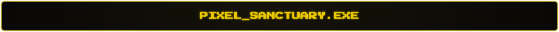
</p>

<p align="center">
  <picture>
    <source media="(prefers-color-scheme: dark)" srcset="https://raw.githubusercontent.com/Cheese-Cheese/Cheese-Cheese/main/dist/pet.svg">
    <source media="(prefers-color-scheme: light)" srcset="https://raw.githubusercontent.com/Cheese-Cheese/Cheese-Cheese/main/dist/pet-light.svg">
    
  </picture>
</p>

<br/>

<!-- Workspace Hardware ASCII -->
<p align="center">
  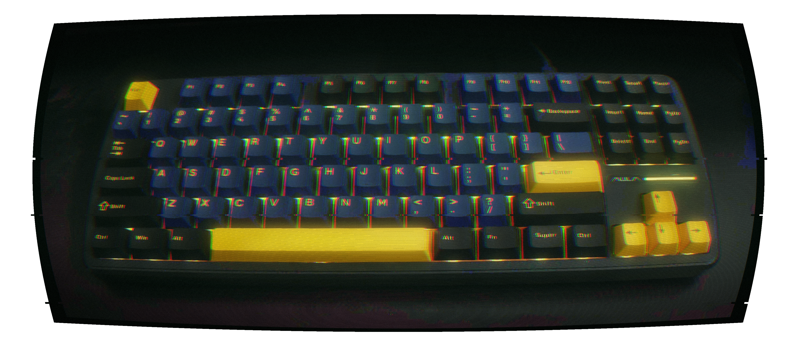
</p>

<br/>

<!-- ========================================== -->
<!--   SECTION: ABOUT ME (THAUS-STYLE TERMINAL) -->
<!-- ========================================== -->
<p align="center">
  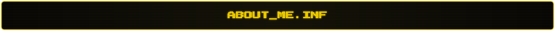
</p>

<table align="center" width="100%">
  <tr>
    <td>
      I am . In order to achieve something great, I believe working with a team with strong chemistry is key. I adapt well to adverse situations while staying positive.
      <br/><br/>
      I am looking for opportunities that challenge me to bring out the best in myself and drive impactful change in the world. I also want to <strong>explore</strong> the <strong>uncharted</strong>.
    </td>
  </tr>
</table>

<br/>

```ini
[SYSTEM_IDENTITY]
NAME         = Ilhan Mansij Jidda
CALLSIGN     = Cheese-Cheese
ROLE         = Software Engineer // AI & Distributed Systems

[CORE_DIRECTIVES]
> Full-Stack & Systems Architecture: Architecting production backends with FastAPI, Flask, and Next.js.
> Real-Time Voice AI: Engineering multi-agent spoken pipelines using LiveKit Agents, Deepgram Nova-3, and Murf Falcon TTS.
> Computer Vision & Multimodal: Building U-Net tissue segmentation, MobileNetV2 classifiers, and Gemini/LLaMa/GPT-OSS multimodal reasoning engines.
> Hackathon-Tested: Engineered clinical diagnostics (MIT Hackathon) and bilingual voice agents (Voice for Bharat).
> Engineering Standard: Finite State Machine (FSM) control flow, strict output validation, and zero hallucinations.
```

<br/>

<!-- ========================================== -->
<!--           SECTION: TECH ARSENAL            -->
<!-- ========================================== -->
<p align="center">
  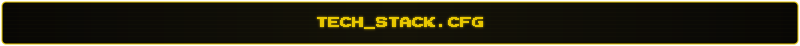
</p>

<table align="center" width="100%">
  <tr>
    <td width="22%"><strong><code>LANGUAGES</code></strong></td>
    <td>
      <a href="https://skillicons.dev">
        
      </a>
    </td>
  </tr>
  <tr>
    <td width="22%"><strong><code>AI / LLM &amp; CV</code></strong></td>
    <td>
      <a href="https://skillicons.dev"></a>
      <a href="https://ai.google.dev" target="_blank"></a>
      <a href="https://groq.com" target="_blank"></a>
      <a href="https://livekit.io" target="_blank"></a>
      <a href="https://deepgram.com" target="_blank"></a>
      <a href="https://murf.ai" target="_blank"></a>
    </td>
  </tr>
  <tr>
    <td width="22%"><strong><code>BACKEND &amp; WEB</code></strong></td>
    <td>
      <a href="https://skillicons.dev"></a>
    </td>
  </tr>
  <tr>
    <td width="22%"><strong><code>DATABASES</code></strong></td>
    <td>
      <a href="https://skillicons.dev">
        
      </a>
    </td>
  </tr>
  <tr>
    <td width="22%"><strong><code>DEVOPS &amp; TOOLS</code></strong></td>
    <td>
      <a href="https://skillicons.dev">
        
      </a>
    </td>
  </tr>
</table>

<br/>

<!-- ========================================== -->
<!--          SECTION: FEATURED BUILDS          -->
<!-- ========================================== -->
<p align="center">
  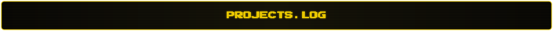
</p>

<table align="center" width="100%">
  <!-- Project 1 -->
  <tr>
    <td width="16%" align="center">
      
      <br/><br/>
      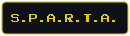
    </td>
    <td>
      <strong>AI-Powered Resume Review &amp; Real-Time Voice Interview Platform</strong>
      <br/>
      Smart Platform for Adversarial Readiness &amp; Technical Assessment. Compares resumes against job descriptions using Groq-hosted LLMs, PyMuPDF extraction, and NVIDIA Nemotron OCR fallback for scanned pages.
      <br/>
      <sub><strong>Key Architecture:</strong> Real-time voice interview engine (Deepgram STT) with Finite State Machine (FSM) orchestration for predictable dataflow, repository coverage reporting, and offline test suites.</sub>
      <br/><br/>
      
      
      
      
      
      &nbsp;&bull;&nbsp;
      <a href="https://github.com/Cheese-Cheese/sparta"><code>[SOURCE_REPO]</code></a>
      &nbsp;&bull;&nbsp;
      <a href="https://sparta-mvp.vercel.app"><code>[LIVE_DEMO]</code></a>
    </td>
  </tr>

  <!-- Project 2 -->
  <tr>
    <td width="16%" align="center">
      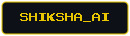
    </td>
    <td>
      <strong>Real-Time Spoken English Voice Tutor (Voice for Bharat Challenge 2026)</strong>
      <br/>
      Engineered a multi-agent spoken English tutor across Murf Falcon streaming TTS, Deepgram Nova-3 STT, and Gemini 2.5 on LiveKit Agents, backed by Next.js and outbound SIP telephony.
      <br/>
      <sub><strong>Key Architecture:</strong> Integrated live dictionary &amp; grammar REST APIs as LLM tools with spoken fail-soft fallbacks, human teacher escalation dashboards, and a 22-test pytest suite.</sub>
      <br/><br/>
      
      
      
      
      
      &nbsp;&bull;&nbsp;
      <a href="https://github.com/Cheese-Cheese/voice-for-bharat-challenge-2026"><code>[SOURCE_REPO]</code></a>
      &nbsp;&bull;&nbsp;
      <a href="https://dev.to/ilhan_mansij_jidda/shiksha-ai-mitra-ai-real-time-spoken-english-roleplay-voice-agent-for-bharat-4n6e"><code>[TECH_ARTICLE]</code></a>
    </td>
  </tr>

  <!-- Project 3 -->
  <tr>
    <td width="16%" align="center">
      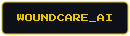
    </td>
    <td>
      <strong>Clinical Support System for Chronic Wound Diagnostics (MIT Hackathon)</strong>
      <br/>
      Dual-model computer vision pipeline combining U-Net semantic segmentation and MobileNetV2 tissue classification with reference-patch calibration converting pixel measurements to real wound surface area (cm&sup2;).
      <br/>
      <sub><strong>Key Architecture:</strong> Flask REST API backend with Streamlit multi-role clinical dashboard (Doctor/Patient portals) and automated PDF diagnostic reporting.</sub>
      <br/><br/>
      
      
      
      
      
      &nbsp;&bull;&nbsp;
      <a href="https://github.com/Cheese-Cheese/MITHackathon"><code>[SOURCE_REPO]</code></a>
    </td>
  </tr>
</table>

<br/>

<!-- ========================================== -->
<!--         SECTION: TELEMETRY & STATS         -->
<!-- ========================================== -->
<p align="center">
  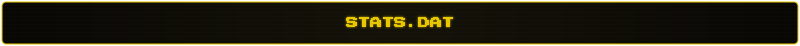
</p>

<div align="center">
  <!-- GitHub Top Languages Card (Amber-Yellow Theme) -->
  
</div>

<br/>

<!-- ========================================== -->
<!-- SECTION: CORE PHILOSOPHY                   -->
<!-- ========================================== -->
<p align="center">
  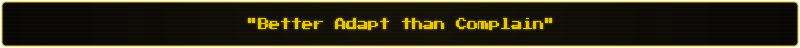
</p>

<br/>

<!-- ========================================== -->
<!--       SECTION: TRANSMISSIONS & COMMS        -->
<!-- ========================================== -->
<p align="center">
  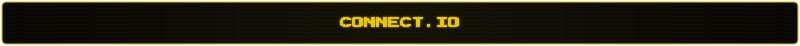
</p>

<div align="center">

<a href="mailto:jidda.ilhaan@gmail.com">
  
</a>
&nbsp;
<a href="https://github.com/Cheese-Cheese">
  
</a>
&nbsp;
<a href="https://dev.to/ilhan_mansij_jidda">
  
</a>
&nbsp;
<a href="https://drive.google.com/file/d/1gtFpTaf0dTC43C-gcSncP-ACU4IWM56T/view?usp=sharing" target="_blank">
  
</a>

<br/><br/>

<sub><code>[EOF] TRANSMISSION TERMINATED // STATUS 200 OK // HOST: CHEESE-CHEESE</code></sub>

</div>
